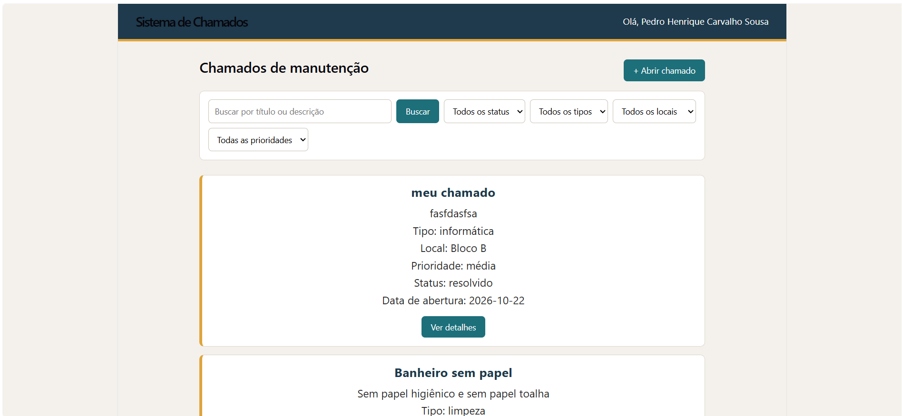
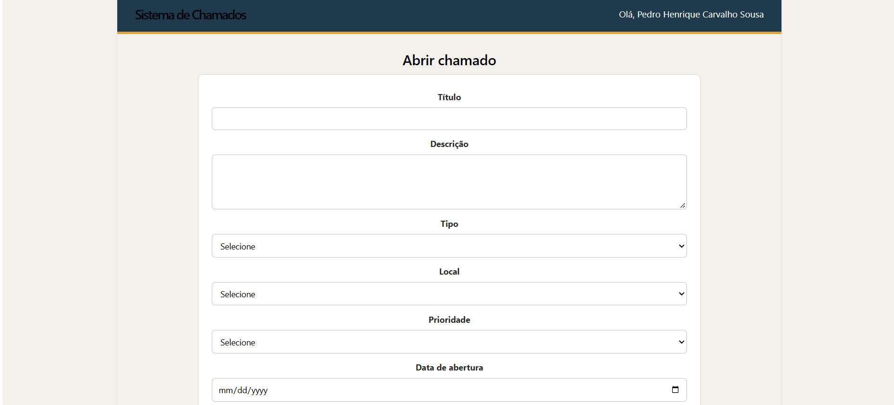
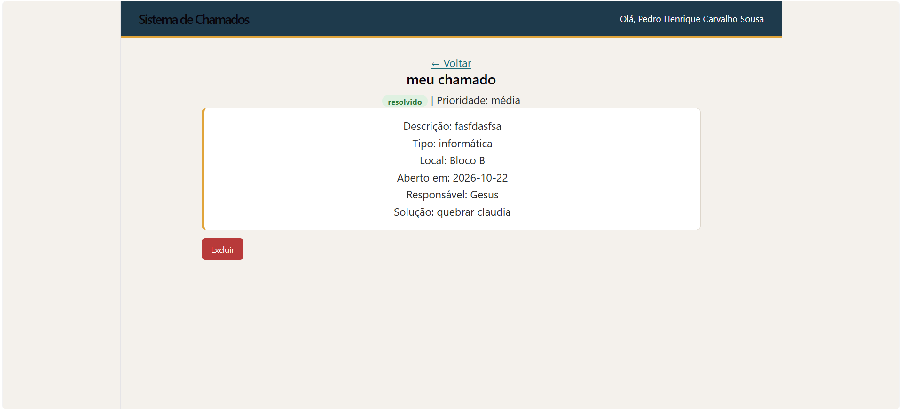

# Sistema de Chamados de Manutenção - IFRN

Front-end do sistema de chamados de manutenção do campus, feito em React + Vite para a disciplina de Programação para Internet (Técnico Integrado em Informática, IFRN Campus Pau dos Ferros).

O sistema consome uma API pronta para abrir chamados, acompanhar o atendimento e registrar a solução. Cada chamado passa por três etapas: **aberto → em andamento → resolvido**.

## Tela 



## Tela de abrir chamado



## Tela de detalhes



## Como rodar

1. Clone o repositório e instale as dependências:

```bash
git clone https://github.com/pedrohenrc/chamados-front.git
cd chamados-front
npm install
```

2. Crie o arquivo `.env` na raiz do projeto com a sua chave da API:

```
VITE_API_KEY=sua-chave-aqui
```

3. Rode o projeto:

```bash
npm run dev
```

Se alterar o `.env`, pare e rode o `npm run dev` de novo.